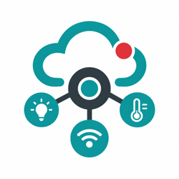

  

# EZVIZ IoT CN

Bring EZVIZ China Open Platform device controls, still images, and native alarm
events into Home Assistant. Device events can be delivered directly through the
Open Platform Message Push webhook.

[English](README.md) | [简体中文](README_zh-Hans.md)

`EZVIZ IoT CN` is an unofficial Home Assistant custom integration for the
official EZVIZ China Open Platform. It exposes supported device state, alarm
arming, alarm sound, PTZ controls, still images, and device-native alarm events.

> [!IMPORTANT]
> This project does not provide live video and does not create a `camera` entity
> for video playback.

## Integration scope

| Area | Connected content |
| --- | --- |
| Platform | China Open Platform application credentials (`AppKey` and `AppSecret`) |
| Devices | Owned and optional shared/managed devices and channels, with include/exclude filtering |
| Entities | Available device controls, state, images, and events, based on verified capabilities or observed events |

## Core features

| Area | What the integration provides |
| --- | --- |
| [Cloud Push Webhook](#cloud-push-webhook) | Receives device-native motion, person, and doorbell/calling events without waiting for the next alarm poll |
| Recovery | Alarm polling recovers missed or delayed events and coordinates state after Home Assistant restarts |
| Controls | Alarm arming, alarm sound, verified alarm flash, and capability-gated PTZ buttons |
| Images | Separate latest capture, alarm, and calling image entities |
| Multiple hubs | Each AppKey creates an independent Home Assistant hub |
| Device filtering | Include only selected devices, or exclude selected devices |
| API awareness | Configurable intervals and a conservative daily usage estimate |

## Installation

### HACS

1. Open **HACS > Integrations**.
2. Open the menu and select **Custom repositories**.
3. Add `https://github.com/wxyjay/ha-ezviz-iot-cn` as an **Integration**.
4. Install **EZVIZ IoT CN** and restart Home Assistant.
5. Open **Settings > Devices & services > Add integration** and search for
   **EZVIZ IoT CN**.

### Manual

1. Copy `custom_components/ezviz_iot_cn` to
   `/config/custom_components/ezviz_iot_cn`.
2. Restart Home Assistant.
3. Add **EZVIZ IoT CN** from **Settings > Devices & services**.

This integration is built against the Home Assistant 2026.9 custom integration
APIs.

## Add a hub and filter devices

The integration uses Open Platform application credentials, not normal EZVIZ
app login credentials.

1. Register or sign in to the [EZVIZ Open Platform](https://open.ys7.com), and
   create an application if you do not already have one.
2. Enter its `AppKey` and `AppSecret` in the Home Assistant configuration flow,
   and accept or edit the hub name. The
   default resembles `EZVIZ IoT CN Hub A7`; it can be edited later in options.
3. In the first configuration step, choose whether to include shared/managed
   devices (on by default). In the next step, select an include or exclude
   filter for the discovered devices.

| Filter mode | Result |
| --- | --- |
| Include selected devices | Load only the selected devices |
| Exclude selected devices | Load all current and future devices except those selected |

Exclude mode with an empty selection includes all accessible devices. The same
AppKey cannot be configured twice; different AppKeys create separate hubs.
If the application lacks access, the device does not support a capability, or
its state cannot be read, the corresponding entity may not be created.

## Home Assistant entities

| Entity | Scope | Creation condition |
| --- | --- | --- |
| Online binary sensor | Device | Every discovered device |
| Motion binary sensor | Channel | A mapped motion or person event has been observed |
| Person binary sensor | Channel | A mapped person/body event has been observed |
| Doorbell ring binary sensor | Channel | A real `ys.calling` ring with `status=1` has been observed |
| Last alarm type and time sensors | Channel | The first valid alarm event has been received |
| Last calling time and calling action sensors | Channel | A valid calling message has been received |
| Alarm arming switch | Device | Defence capability is present; unavailable while state is unreadable |
| Alarm sound select | Device | A non-shared device reports `support_alarm_voice > 0` and a valid `alarmSoundMode` (0, 1, or 2) from its status endpoint |
| Alarm flash switch | Device | A non-shared device reports light capability 2 and the public status endpoint verifies protocol 301/305 and current state |
| Refresh status button | Device | Every discovered device; each hub refreshes at most once per minute |
| Local API request/rate-limit counts and refresh button | Hub | Local observations since integration startup, not official quota |
| PTZ direction buttons | Channel | The capability set exposes the relevant axis |
| Latest capture image | Channel | Scheduled capture is enabled and supported; unavailable until the first successful capture |
| Latest alarm image | Channel | Event images enabled and an alarm image observed; unavailable until download succeeds |
| Latest calling image | Channel | Event images enabled and a calling cover observed; unavailable until download succeeds |

Motion and person entities appear after the first matching event on a channel;
the observed capability remains available after a restart. Arming does not
change the camera's detection algorithm. Refresh status re-reads device state,
arming, alarm events, and sound/light settings; each hub refreshes at most once
per minute. Calling status `1` means ring, `2` answer, and `3` hang-up.

## Cloud Push Webhook

When a device raises an alarm, EZVIZ Cloud Push sends the event directly to
Home Assistant through the webhook without waiting for a scheduled query. The
integration then updates the corresponding motion, person, doorbell, and image
entities.

### Enable Cloud Push

1. Enable **Native webhook** in the integration options and save. Home Assistant
   also displays a notification with the private URL when it is first generated.
2. Reopen the options page to obtain the current webhook URL. If only a
   relative path is shown, configure a trusted Home Assistant external URL
   or HTTPS reverse proxy first.
3. We recommend publishing the webhook through a trusted HTTPS reverse proxy or
   tunnel and exposing only its exact `/api/webhook/...` path.
4. Under the account used for message delivery, open **Open Platform Console >
   Cloud Signaling > Message Push**, enter the URL, and enable the Open Platform
   **Message Push** feature.
5. Verify delivery with an actual device event. Keep alarm polling enabled to
   recover missed events.

> [!TIP]
> To verify that a reverse proxy, tunnel, or webhook URL is reachable, temporarily
> enable **Message Test** under **Open Platform Console > Cloud Signaling >
> Message Push** and enter the webhook URL. Test messages use a virtual device
> and only validate the URL and response; they do not update real device entities.
> Actual device messages stop while Message Test is enabled, so disable it as
> soon as testing is complete.

> [!NOTE]
> After the Open Platform **Message Push** feature is enabled for an account,
> the EZVIZ app on that account will no longer receive related device
> notifications. [See usage guidance](#app-notification-solution)

## App notification impact and usage guidance

[EZVIZ's official Message Push feature documentation](https://open.ys7.com/help/5129)
states that after the Open Platform **Message Push** feature is enabled for an
account, the official EZVIZ app no longer receives related device notifications
for that account. Disabling the feature later does not automatically restore
app notifications.

> [!TIP]
> If the feature was enabled unintentionally and EZVIZ app notifications need
> to be restored, submit a support ticket through the Open Platform for manual
> recovery.

To preserve notifications on the primary account, use a dedicated account for
the Open Platform **Message Push** feature:

1. Keep the devices on the primary account and continue using it in the
   official app.
2. Create a dedicated EZVIZ account for Message Push.
3. In the EZVIZ app, share the devices to be integrated from the primary
   account to the dedicated account.
4. Register an Open Platform application with the dedicated account.
5. Use the primary account's Open Platform `AppKey` and `AppSecret` to add the
   Home Assistant hub.
6. Enable **Native webhook** in the hub options, save, and obtain the generated
   webhook URL.
7. Sign in to the dedicated account's **Open Platform Console > Cloud Signaling
   > Message Push**, enter the URL, and enable the Open Platform **Message Push**
   feature.

The dedicated account and its Open Platform application are used only to enable
Message Push and send shared-device events to the webhook. The Home Assistant
hub continues to use the primary account's Open Platform application credentials.

## API quota and polling

Alarm polling recovers missed or delayed events and coordinates events after a
Home Assistant restart.

| Option | Default | Range or behavior |
| --- | ---: | --- |
| Alarm-event polling | Enabled | Recover missed events |
| Alarm polling interval | 10 seconds | 10 seconds to 1 hour |
| Device-state interval | 60 seconds | 30 seconds to 1 hour |
| Metadata interval | 6 hours | 1 hour to 24 hours |
| Scheduled captures | Disabled | Opt in; platform API requests may wake devices |
| Capture interval | 10 minutes | 5 minutes to 24 hours |

The options page estimates daily API requests. Increase polling intervals or
disable scheduled captures to reduce usage. Hub request and rate-limit counts
are local observations from the current run, not an official remaining quota;
the refresh-counts button does not contact the platform. Temporary event-image
downloads use a separate session and are not included in those API counts.

## Security and privacy

- Treat the webhook URL, `AppKey`, `AppSecret`, and access tokens as sensitive
  credentials; do not share them in screenshots, YAML, logs, diagnostics,
  issues, or examples.
- We recommend HTTPS and exposing only the exact `/api/webhook/...` route while
  keeping the Home Assistant management interface private.
- The webhook must return HTTP 200 with the original `messageId` within two
  seconds; unreachable or incorrect responses can trigger retries or delivery
  degradation. HTTP 200 acknowledges receipt, not completed event processing.
- The integration does not verify the optional callback signature. Protect the
  private URL; any additional origin validation belongs at the public entry point.
- Platform API requests use Home Assistant's shared `aiohttp` session; temporary
  image downloads use a separate session with connection-time destination checks.
- Diagnostics redact credentials and identifiers.

## Known limitations and troubleshooting

- This integration does not decrypt or process encrypted alarm images.
- Cloud delivery and API quota remain subject to the Open Platform.

See [Troubleshooting](docs/troubleshooting.md) for authentication, device
discovery, quota, image, and webhook checks. See
[API mapping](docs/api-mapping.md) for endpoint and event type details.

## Removal

1. Remove the hub from **Settings > Devices & services**.
2. Remove its callback under **Open Platform Console > Cloud Signaling > Message
   Push**.
3. Delete `custom_components/ezviz_iot_cn` if installed manually.
4. Restart Home Assistant.

## License

This project is not affiliated with or endorsed by EZVIZ or Hangzhou Hikvision
Digital Technology Co., Ltd. Use it only with devices and accounts you own or
are authorized to manage, and comply with applicable laws, privacy obligations,
and EZVIZ Open Platform rules. You are responsible for your deployment and its
consequences.

Licensed under the [MIT License](LICENSE).
