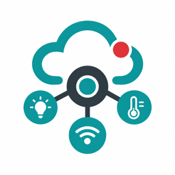

  

# EZVIZ IoT CN

通过萤石中国区官方开放平台，将设备控制、静态图片和原生告警事件接入
Home Assistant；设备事件可通过开放平台「消息推送」Webhook 直接接收。

[English](README.md) | [简体中文](README_zh-Hans.md)

`EZVIZ IoT CN` 是一个面向萤石中国区官方开放平台的非官方 Home Assistant
自定义集成，可接入设备状态、告警布防、告警声音、云台控制、静态图片以及设备原生
告警事件。

> [!IMPORTANT]
> 本项目不提供实时视频，也不会创建用于播放视频的 `camera` 实体。

## 接入范围

| 接入项 | 内容 |
| --- | --- |
| 平台 | 使用中国区开放平台应用的 `AppKey` 和 `AppSecret` 接入 |
| 设备 | 发现自有及可选的共享/托管设备与通道，支持包含/排除筛选 |
| 实体 | 根据已确认的能力或实际事件，提供可用的设备控制、状态、图片和事件 |

## 核心功能

| 范围 | 本集成提供的能力 |
| --- | --- |
| [Cloud Push Webhook](#cloud-push-webhook) | 通过 Webhook 接收设备原生移动、人员和门铃/呼叫事件，无需等待下一轮告警轮询 |
| 事件恢复 | 告警轮询恢复遗漏或延迟事件，并在 Home Assistant 重启后协调事件状态 |
| 设备控制 | 告警布防、告警声音、经状态确认的闪光灯与按能力创建的云台按钮 |
| 图片 | 最新抓拍、告警图片和呼叫图片相互独立 |
| 多 Hub | 每个 AppKey 创建一个独立的 Home Assistant Hub |
| 设备筛选 | 仅包含所选设备，或排除所选设备 |
| API 用量 | 可配置间隔和保守的每日用量估算 |

## 安装

### HACS

1. 打开 **HACS > 集成**。
2. 打开菜单并选择**自定义存储库**。
3. 添加 `https://github.com/wxyjay/ha-ezviz-iot-cn`，类别选择**集成**。
4. 安装 **EZVIZ IoT CN** 并重启 Home Assistant。
5. 打开**设置 > 设备与服务 > 添加集成**，搜索 **EZVIZ IoT CN**。

### 手动安装

1. 把 `custom_components/ezviz_iot_cn` 复制到
   `/config/custom_components/ezviz_iot_cn`。
2. 重启 Home Assistant。
3. 在**设置 > 设备与服务**中添加 **EZVIZ IoT CN**。

本集成基于 Home Assistant 2026.9 的自定义集成 API 开发。

## 添加 Hub 与筛选设备

本集成使用开放平台应用凭据，不使用普通萤石 App 登录凭据。

1. 注册或登录[萤石开放平台](https://open.ys7.com)，尚未创建应用时按需创建应用。
2. 在 Home Assistant 配置流程中输入 `AppKey`、`AppSecret`，并确认或修改
   Hub 名称。默认名称类似 `EZVIZ IoT CN Hub A7`，以后仍可在集成选项中修改。
3. 在配置的第一步选择是否包含共享/托管设备（默认开启），然后在下一步对发现的
   设备选择包含或排除筛选模式。

| 筛选模式 | 结果 |
| --- | --- |
| 包含所选设备 | 只加载所选设备 |
| 排除所选设备 | 加载当前及未来新增的全部设备，但排除所选设备 |

排除模式且选择列表为空时，会包含应用可访问的全部设备。同一个 AppKey 不能重复
配置；不同 AppKey 会创建相互独立的 Hub。应用无权访问、设备不支持或状态不可读
时，对应实体可能不会创建。

## Home Assistant 实体

| 实体 | 范围 | 创建条件 |
| --- | --- | --- |
| 在线二进制传感器 | 设备 | 所有已发现设备 |
| 移动侦测二进制传感器 | 通道 | 已观察到映射的移动或人员事件 |
| 人员检测二进制传感器 | 通道 | 已观察到映射的人员/人体事件 |
| 门铃呼叫二进制传感器 | 通道 | 已观察到真实 `ys.calling` 响铃事件（`status=1`） |
| 最后告警类型与时间传感器 | 通道 | 收到首个有效告警事件 |
| 最后呼叫时间与呼叫动作传感器 | 通道 | 收到有效呼叫消息 |
| 告警布防开关 | 设备 | 设备能力支持布防；状态不可读时不可用 |
| 告警声音选择 | 设备 | 非共享设备报告 `support_alarm_voice > 0`，且状态接口返回有效 `alarmSoundMode`（0、1 或 2） |
| 告警闪光灯开关 | 设备 | 非共享设备报告灯光能力 2，且公开状态接口确认 301/305 协议及当前状态 |
| 刷新状态按钮 | 设备 | 每个已发现设备；同一 Hub 每分钟最多执行一次刷新 |
| API 请求/限流计数与刷新计数按钮 | Hub | 本次集成运行期间的本地观测值，不是官方配额 |
| 云台方向按钮 | 通道 | 官方能力集支持对应方向轴 |
| 最新抓拍图片 | 通道 | 已启用定时抓拍且设备支持抓拍；首次成功抓拍前不可用 |
| 最新告警图片 | 通道 | 已启用事件图片且观察到告警图片；成功下载前不可用 |
| 最新呼叫图片 | 通道 | 已启用事件图片且观察到呼叫封面；成功下载前不可用 |

移动和人员实体在对应通道首次收到匹配事件后创建，重启后保留已观察到的能力。
布防不会改变摄像机的侦测算法。刷新状态会重新读取设备状态、布防、告警事件及
声音/灯光配置；同一 Hub 每分钟最多执行一次刷新。呼叫状态 `1` 为响铃、`2` 为
接听、`3` 为挂断。

## Cloud Push Webhook

设备产生告警后，萤石 Cloud Push 会通过 Webhook 将事件直接发送到 Home
Assistant，无需等待定时查询；本集成收到事件后更新对应的移动、人员、门铃和
图片实体。

### 启用 Cloud Push

1. 在集成选项中启用**原生 Webhook**并保存。首次生成地址时，Home Assistant
   也会显示一条包含私有 URL 的通知。
2. 重新打开选项页面，取得当前 Webhook URL；若只有相对路径，先配置可信的
   Home Assistant 外部 URL 或 HTTPS 反向代理。
3. 建议通过可信的 HTTPS 反向代理或隧道公开 Webhook，并仅开放精确的
   `/api/webhook/...` 路径。
4. 在用于消息推送的账号下，进入**开放平台控制台 > 云信令 > 消息推送**，填写
   该 URL，并开启开放平台「消息推送」功能。
5. 用设备真实事件验证接收情况。保留告警轮询，以恢复遗漏事件。

> [!TIP]
> 如需验证反向代理、隧道或 Webhook URL 是否可达，可在**开放平台控制台 >
> 云信令 > 消息推送**中临时开启**消息测试**并填写 Webhook URL。测试消息使用
> 虚拟设备，只用于验证 URL 和响应，不会更新真实设备实体。开启消息测试期间，
> 实际设备消息将停止推送；测试完成后请立即关闭该功能。

> [!NOTE]
> 账号开启开放平台「消息推送」功能后，该账号的萤石云 App 将不再接收相关设备
> 通知。[查看使用建议](#app-notification-solution)

## App 通知影响与使用建议

根据[萤石官方「消息推送」功能文档](https://open.ys7.com/help/5129)，账号开启
开放平台「消息推送」功能后，将无法继续在萤石云 App 中接收相关设备通知；关闭
该功能后，App 通知也不会自动恢复。

> [!TIP]
> 若意外开启该功能并需要恢复 App 通知，请在开放平台提交工单，申请人工恢复。

如需保留主账号的 App 通知，建议为开放平台「消息推送」功能使用专用账号：

1. 主账号继续持有设备并用于官方 App。
2. 创建一个专用于消息推送的萤石账号。
3. 主账号在萤石云 App 中，将需要接入的设备共享给专用账号。
4. 使用专用账号注册开放平台应用。
5. 使用主账号开放平台应用的 `AppKey` 和 `AppSecret` 添加 Home Assistant Hub。
6. 在 Hub 选项中启用**原生 Webhook**并保存，取得生成的 Webhook URL。
7. 登录专用账号的**开放平台控制台 > 云信令 > 消息推送**，填写该 URL 并开启
   开放平台「消息推送」功能。

专用账号及其开放平台应用只用于启用消息推送，并将共享设备事件发送到 Webhook；
Home Assistant Hub 仍使用主账号的开放平台应用凭据。

## API 配额与轮询

告警轮询用于恢复遗漏或延迟事件，并在 Home Assistant 重启后协调事件状态。

| 选项 | 默认值 | 范围或行为 |
| --- | ---: | --- |
| 告警事件轮询 | 启用 | 恢复遗漏事件 |
| 告警轮询间隔 | 10 秒 | 10 秒到 1 小时 |
| 设备状态间隔 | 60 秒 | 30 秒到 1 小时 |
| 元数据刷新间隔 | 6 小时 | 1 小时到 24 小时 |
| 定时抓拍 | 关闭 | 按需启用；API 请求可能唤醒设备 |
| 抓拍间隔 | 10 分钟 | 5 分钟到 24 小时 |

选项页面会估算每日 API 请求量。需要降低用量时，可增大轮询间隔或关闭定时抓拍。
Hub 的请求和限流计数只是本次运行的本地观测值，不代表官方剩余额度；刷新计数
按钮不会请求平台。临时事件图片使用独立会话下载，不计入这些 API 请求数。

## 安全与隐私

- Webhook URL、`AppKey`、`AppSecret` 和 access token 均为敏感凭据，
  不要在截图、YAML、日志、诊断、Issue 或示例中分享。
- 建议使用 HTTPS，并仅公开精确的 `/api/webhook/...` 路径，避免公开
  Home Assistant 管理界面。
- Webhook 必须在 2 秒内返回 HTTP 200 和原始 `messageId`；不可达或响应有误
  可能触发重试或推送服务降级。HTTP 200 表示已确认接收，不代表事件处理完成。
- 本集成不校验平台可选的回调签名。请妥善保管私有 URL；如需验证来源，应在公开
  入口处实施。
- 平台 API 请求使用 Home Assistant 共享的 `aiohttp` 会话；临时图片下载使用
  独立会话，并在连接时检查目标地址。
- 诊断会脱敏凭据和标识符。

## 已知限制与故障排查

- 本集成不会解密或处理已加密的告警图片。
- 云端消息投递和 API 额度仍受开放平台约束。

认证、设备发现、配额、图片和 Webhook 问题请参阅
[故障排查](docs/troubleshooting.md)。接口与事件类型说明请参阅
[API 映射](docs/api-mapping.md)。

## 移除

1. 在**设置 > 设备与服务**中删除 Hub。
2. 在**开放平台控制台 > 云信令 > 消息推送**中删除该回调地址。
3. 如果是手动安装，删除 `custom_components/ezviz_iot_cn`。
4. 重启 Home Assistant。

## 许可证

本项目与萤石或杭州海康威视数字技术股份有限公司无隶属或背书关系。请仅将本项目
用于自己拥有或已获授权管理的设备和账号，并遵守适用的法律法规、隐私义务和萤石
开放平台规则。您应对自己的部署和使用后果负责。

本项目采用 [MIT License](LICENSE)。
